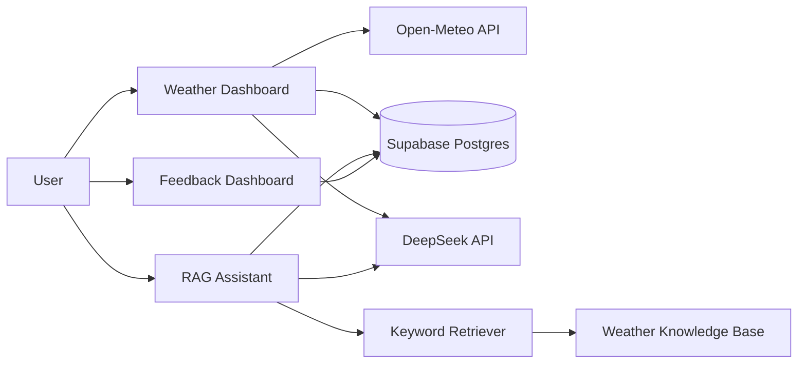

# FDE Portfolio: Weather Data & AI Assistant


一个从零构建的 FDE（Forward Deployed Engineer）实践项目：实时天气数据、Supabase Postgres、LLM 出行建议、带引用的 RAG 知识助手、用户反馈闭环，以及自动化评测和 CI。

## English Summary

A production-shaped FDE portfolio project built from scratch: real-time weather ingestion, Supabase Postgres persistence, LLM-generated advice with rule-based fallback, retrieval-augmented generation with citations, a feedback and triage loop, automated evaluation, and CI.

## 在线演示

- [天气数据应用（Supabase Postgres）](https://fde-weather-cloud.streamlit.app/)
- [RAG 天气知识助手](https://fde-weather-rag.streamlit.app/)
- 反馈看板：本地运行 `streamlit run day09/feedback_dashboard.py`，也可以按同样方式部署

## 核心能力

- 上海、北京、深圳实时天气查询与温度趋势
- Open-Meteo API → JSON 解析 → Supabase Postgres 持久化
- DeepSeek 生成出行建议，API 失败时自动回退到规则引擎
- RAG 检索天气知识库，回答带引用来源；资料不足时明确拒答
- 用户好评/差评、处理状态和备注，支持差评闭环跟踪
- 受限数据库用户 + RLS，避免应用使用超级用户
- pytest 34 个测试，覆盖率 84.62%，ruff + GitHub Actions

## 架构



## 数据与 AI 链路

### 天气数据

```text
Open-Meteo API
  → requests
  → JSON 解析
  → Supabase Postgres
  → Streamlit 图表与指标
```

### 出行建议

```text
当前温度 + 风速 + 历史变化
  → DeepSeek
  → 结构化建议与风险等级
  → 失败时回退到规则引擎
```

### RAG 知识助手

```text
用户问题 + 当前天气
  → 关键词检索
  → 相关资料片段
  → DeepSeek
  → 带引用的回答
  → 资料不足时拒答
```

### 反馈闭环

```text
👍 / 👎
  → Supabase rag_feedback
  → 反馈看板
  → 失败分类
  → 处理状态 / 备注
  → 回归测试
```

## 评测结果

- 出行建议评测：12/12，覆盖高温、低温、大风、升降温、风险等级和长度
- RAG 评测：9/9，覆盖检索命中、引用有效性、拒答和一般知识问题
- 自动化测试：34 passed
- 覆盖率：84.62%，最低门槛 70%
- 代码检查：ruff 通过
- CI：每次 push 自动运行 lint + pytest

这些是固定测试集上的基线结果，不代表生产环境的全部正确性；真实交付还需要更大规模、多样化的评测集。

## 安全设计

- API Key 和数据库连接串只放在本地 `.streamlit/secrets.toml` 和 Streamlit Cloud Secrets
- `.streamlit/secrets.toml` 已被 `.gitignore` 排除
- 应用使用受限用户 `weather_app`，不能创建角色、创建数据库或建表
- `weather` 和 `rag_feedback` 通过 GRANT 和 RLS 策略限制权限
- 表结构变更由管理员在 Supabase SQL Editor 执行
- 反馈看板目前没有登录鉴权，生产环境应增加 SSO/角色控制

## 项目结构

```text
day01/   Python 基础、密码检查器
day02/   列表、字典、JSON、任务清单
day03/   SQLite、任务清单网页版
day04/   天气 API、城市选择、趋势图
day05/   SQL JOIN、GROUP BY、聚合统计
day06/   Supabase Postgres、受限用户、LLM 建议
day07/   规则版天气建议
day08/   真实模型建议与评测
day09/   RAG 知识助手、反馈闭环、反馈看板
```

## 本地运行

安装依赖：

```powershell
python -m pip install -r requirements.txt
```

复制配置模板，并填入 Supabase 和 LLM 配置：

```text
.streamlit/secrets.toml.example → .streamlit/secrets.toml
```

启动天气应用：

```powershell
streamlit run day06/weather_web_postgres.py
```

启动 RAG 助手：

```powershell
streamlit run day09/rag_web.py
```

启动反馈看板：

```powershell
streamlit run day09/feedback_dashboard.py
```

## 测试与质量检查

```powershell
python -m pip install -r requirements-test.txt
ruff check .
python -m pytest -q
```

## 作品集材料

- [案例复盘](docs/case_study.md)
- [3 分钟演示脚本](docs/demo_script.md)

## 学习时间线

### 2026-10-19

- 安装 Python、VS Code、Git
- 完成第一个 Python 脚本和 Git 提交

### 2026-10-20

- 完成密码检查器、任务清单、JSON 和 SQLite
- 完成天气 API 与 Streamlit 页面
- 部署到 Streamlit Community Cloud

### 2026-10-21

- 增加多城市和趋势图
- 迁移到 Supabase Postgres
- 增加受限数据库用户和 RLS

### 2026-10-22

- 接入 DeepSeek 出行建议与规则回退
- 建立建议评测集和 RAG 助手
- 增加用户反馈与差评闭环

### 2026-10-23

- 增加 ruff、覆盖率和 GitHub Actions
- 完成 RAG 与建议评测
- 整理作品集文档
